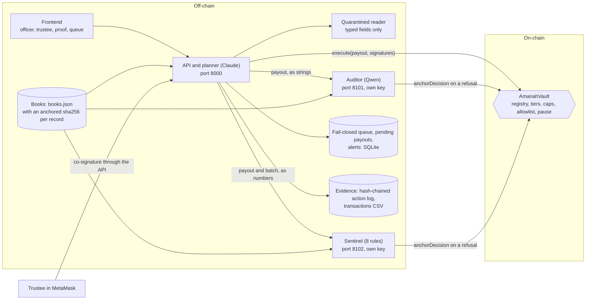

# Technical documentation

Plan task E3. This describes Amanah as built in this repository, for a reader who wants to run it, check it or extend it. The problem, the users and the design argument are in the README, sections 1 to 6.

Status: draft from the cloud session, 18 October 2026. It describes the code on `lane/release`. Numbers from the Base Sepolia run and the red-team full run are marked `[[fill]]`.

## 1. What runs where

| process | port | holds | code |
|:--|--:|:--|:--|
| AmanahVault, on Base Sepolia (Anvil locally) | | the funds, the signer registry, mandates, allowlist, posture and anchored decisions | `contracts/src/AmanahVault.sol` |
| API and planner | 8000 | the planner's key and the relayer's key | `backend/app/main.py`, `backend/app/agentwallet/` |
| auditor service | 8101 | the auditor's key only | `backend/app/agentwallet/auditor/` |
| sentinel service | 8102 | the sentinel's key only | `backend/app/agentwallet/sentinel/` |
| frontend | 5173 | no keys; trustees sign in MetaMask | `frontend/` |
| immune loop, on demand or daily | | the posture oracle's key | `redteam/immune.py`, `backend/app/agentwallet/posture.py` |

`bash scripts/dev_up.sh` starts the first four on Anvil. Each service gets only its own key from the environment.

## 2. One payout

1. **Understand.** The officer writes in the chat. The planner model (`planner/propose.py`, schema `ACTIONS`) maps the request to one of 7 actions:
   - `pay_batch`, `pay_request`, `pay_beneficiary` or `pay_wallet`;
   - `clarify`, `refuse` or `chat`.

   An ambiguous request gets one clarifying question with options.
2. **Plan.** The plan card is built from the books, one intent per household. A registered beneficiary's amount always comes from the books (`strict_books_amounts=True`). The tier preview reads the vault's spend and posture.
3. **Correct.** "Leave out household 12" re-plans with the same batch id.
4. **Sign.** On Confirm, each intent becomes an EIP-712 `Payout` (`shared/eip712.json`), signed with the planner's key.
5. **Check.** The auditor and the sentinel are asked in parallel (`checkers.py`):
   - **The auditor** gets the payout and nothing else. It rebuilds a case file from the books: status, eligibility date, last three payouts, household size band. There are no names, no notes and no chat (`auditor/casefile.py`). It checks each record's anchored hash, then asks Qwen with a contrarian prompt.
   - **The sentinel** computes 9 numeric features from the books, the batch and the vault's own records, and applies 8 rules (`sentinel/rules.py`). It counts a household's past payouts from the vault's `PayoutExecuted` events and reads today's spend from `spentToday`, so a lost backend ledger hides nothing (`sentinel/judge.py`, decision B-17).
   - Each signs only on APPROVE. Each anchors its own REJECT or ESCALATE on-chain.
6. **Submit.** The planner asks the vault for the tier:
   - A routine payout goes to `execute` with three signatures.
   - An elevated one waits for a trustee, with typed data and a plain-words summary written from the decoded fields (`reporter.py`).
   - A missing checker or an unreachable chain queues the payout and alerts a trustee. The queue retries every 60 seconds (`queue.py`).
7. **Record.** Every step goes to the hash-chained action log, and every transaction to `transactions.csv` with its scenario tag (`evidence.py`).

## 3. Agents and what each one sees

| agent | lineage | model from | sees | never sees | signs |
|:--|:--|:--|:--|:--|:--|
| planner | anthropic/claude | `PLANNER_MODEL` | the chat, and the books' programmes, batches and requests without personal data, and documents only as typed fields | identity numbers, names, addresses, raw documents | every intent it proposes |
| reader | anthropic/claude | `READER_MODEL` or `PLANNER_MODEL` | one uploaded document | the books, the chat | nothing; it has no tools |
| auditor | alibaba/qwen | `AUDITOR_MODEL`, fails over to `AUDITOR_FALLBACK_MODEL` | the payout and its own case file | the chat, notes, documents, personal data | APPROVE only |
| sentinel | symbolic/rules | no model | numbers: features from the books, the batch and the vault's payout events | any text | APPROVE only |
| control auditor | anthropic/claude | `AUDITOR_CONTROL_MODEL` | as the auditor | as the auditor | used only for red-team arm S2 and scenario 11 |
| GPT auditor | openai/gpt | `AUDITOR_GPT_MODEL` | as the auditor | as the auditor | nothing: a measurement in the joint-failure matrix |
| red-team agent | openai/gpt, Groq fallback | `REDTEAM_MODEL` | attack seeds | the product | nothing |

Model names come only from `.env`; the code names none (decision B-6). Every reply records the model that served it, its lineage and the sha256 of its input. Prompts are in `backend/app/agentwallet/prompts/`, one file per agent, with fingerprints in every red-team manifest.

## 4. The vault

The interface is `contracts/src/IAmanahVault.sol` (plan section 3.2), and the corrected excerpt for the README is in `docs/readme-audit.md`.

- **Tier 1, routine.** The planner, an auditor of a different lineage and the sentinel. The amount is at or under the cap, the day's spend is at or under 80% of the daily budget, and the posture is normal.
- **Tier 2, elevated.** The routine quorum plus one trustee.
- **Tier 3, override.** The planner and two trustees, citing an anchored REJECT or ESCALATE for the same proposal. Hard limits still apply.
- **Always.**
  - The beneficiary is allowlisted and past its cooling-off.
  - The mandate is active.
  - The amount is within the hard ceiling, the daily budget and the 30-day cap.
  - The nonce is unused, the deadline has not passed, and the vault is not paused.
- **Governance.** Two of three trustees sign EIP-712 `Governance` messages, and the vault verifies them itself. The deployer holds no role.

Tests: 112, including 8 invariants over 16,384 calls each and 12 planted bugs, all caught, and 3 for the demo token (`docs/contract-tests.md`).

- **The demo token.** On Base Sepolia the vault holds `TestUSDC` (tUSDC), 6 decimals like USDC, minted only by its owner. Circle's testnet faucet gives about 20 USDC a request and the demo deposits 5,000. The vault takes its token's address at deployment, so a production vault takes Circle's USDC with no code change (decision A-12).

## 5. Data

- **The books.** `redteam/data/books.json` is a synthetic institution: 3 funds, 3 programmes, 45 beneficiaries, 49 past payouts, 3 batches (October's zakat aid and flood relief, and the second semester's bursaries), 2 requests, 3 notes and 1 donation receipt (`shared/books.md`).
  - It is generated deterministically by `python -m redteam.datagen`.
  - Identity numbers have the form `999999-99-NNNN` and are not real.
  - Each beneficiary's id hash is an HMAC under `INSTITUTION_HMAC_KEY`, the institution's key, which lives only in `.env`. The committed data was generated with it on 19 October 2026.
- **On-chain.** A beneficiary is a wallet and a keyed hash, and a programme is an opaque id.
- **Integrity.** `books_anchor.json` holds a sha256 per record, and the auditor checks every record it reads against it.

## 6. API

`docs/api.md` documents every route, its role, its shapes and its errors: the 9 routes of plan section 3.3, and 5 additions (health, the public usage report, alerts, payout status, scheduled batches).

## 7. Deployment

1. **Deploy and verify the token, then the vault.** `forge script script/DeployToken.s.sol --rpc-url base_sepolia --broadcast --verify` deploys TestUSDC, mints the donor's deposit and writes `contracts/deployments/84532-token.json`. With `USDC_ADDRESS` set to that token, `forge script script/Deploy.s.sol --rpc-url base_sepolia --broadcast --verify` deploys the vault. Both scripts refuse any chain but Base Sepolia and Anvil; the vault's writes `contracts/deployments/84532.json`.
2. **Run the demo.** `python scripts/run_demo.py --network base-sepolia` does the rest:
   - it registers the signers, sets the three mandates and adds the beneficiaries, with two trustees signing each;
   - it waits out the cooling-off;
   - it starts the auditor and the sentinel as their own services, each with only its own key, and runs the scenarios;
   - it anchors the action log's head.
   The same path was rehearsed against Anvil with chain id 84532 (`docs/handoff/lane-e.md`).
3. **Start the services.** Run the API, the auditor and the sentinel with their own keys (`docs/readme-audit.md` has the commands). Build the frontend with `VITE_VAULT_ADDRESS` and `VITE_CHAIN_ID=84532`.

## 8. Testing and results

| suite | count | command |
|:--|--:|:--|
| contracts | 112 | `cd contracts && forge test` |
| backend | 133, and 4 live smoke tests with keys | `cd backend && python -m pytest` |
| red team | 25 | `python -m pytest -c redteam/pytest.ini redteam/tests` |
| release scripts | 28 | `python -m pytest -p no:cacheprovider scripts/tests` |
| frontend unit | 24 | `cd frontend && npm test` |
| frontend browser, mock backend | 14 | `cd frontend && npx playwright test` |
| frontend browser, real stack on Anvil | 3 | `cd frontend && npx playwright test --config playwright.stack.config.ts` |
| the 16 scenarios on Anvil, self-checking | 17 checks; 16 pass and scenario 7 waits on decision A-10 | `python scripts/run_demo.py --network anvil` |

`bash scripts/test_all.sh` runs them all. The red-team full run writes `redteam/results/final/report.md`, and the Base Sepolia run writes `evidence/` (`evidence/README.md`).

## 9. Licences

- **Dependencies.** OpenZeppelin Contracts v5.7.0 and forge-std are MIT. The Python and npm dependencies are pinned in `backend/requirements.txt` and `frontend/package-lock.json`.
- **This project.** [[fill: project licence]].
